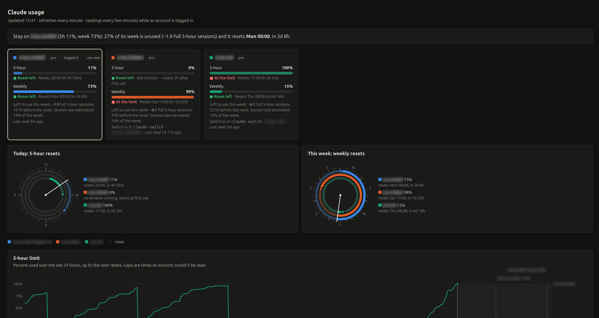

# Claude usage tracker

Tracks the 5-hour and weekly plan limits of several Claude accounts used with
Claude Code, says which account to use so the least of each week goes unused,
and switches Claude Code between them without logging in again.

Linux, Python 3 (standard library only), systemd user timers, `notify-send`.

## Install

    ./install.sh

Then `/login` once in Claude Code to each account you use. The tracker saves
each login the first time it sees it.

## Use

- `claude-usage open` – the dashboard: a card per account (each limit, its
  reset, full 5-hour sessions left to use this week); two clocks, a 24-hour
  face (noon at the top) with each account's current 5-hour window and its reset, and a
  Monday-to-Sunday face with each account's week and its reset; and a chart
  for each limit, every account a line in its colour, resets marked. It
  refreshes itself every minute.
- `claude-switch [account|next|best]` – switch Claude Code to another saved
  login. Running sessions pick it up, as Claude Code reloads its credentials
  file when it changes.
- `claude-usage status` – one line, e.g. for Claude Code's status line.
- `claude-usage name <account> <nickname>` – rename an account.
- `claude-usage auto on|off` – switch by itself when the logged-in account
  runs out (on by default).

A notification comes once as a limit crosses 95% and once as it reaches 100%
(each window, 5-hour and weekly), with a **Switch now** button, and when another account's week is closer
to going to waste.

## How it works

Every 3 minutes `tracker.py poll` asks Claude's usage endpoint (the numbers
`/usage` shows; asking uses none of the limit) for the logged-in account, and
for each other saved login while its access token is still good. It never
refreshes a token itself, as that would replace the refresh token Claude Code
holds.

Which account to use: of those with room in both limits now, the one with the
most weekly percent per hour still to use before its week resets (a week not
started yet counts as one starting now), keeping to
the logged-in one unless another is clearly more pressing.

State, all private to you, is in `~/.local/state/claude-usage/`: `log.jsonl`
(readings), `accounts.json` (names), `logins/` (saved logins, mode 0600),
`dashboard.html`.

`./uninstall.sh` removes the timer and commands; the state folder stays.

The usage endpoint and the credentials file's layout are Claude Code's own and
undocumented, so a Claude Code update may change them.

## License

MIT, see [LICENSE](LICENSE).
